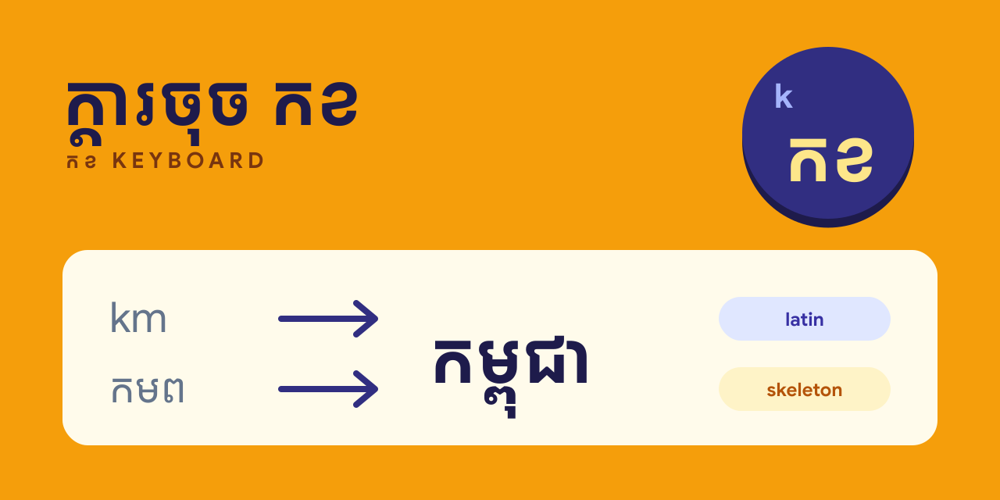

  

<h1 align="center">កខ Keyboard downloads</h1>

  <b>ក្ដារចុច កខ</b> — smart Khmer keyboard by <a href="https://www.somara-ab.com/en/products/kkeyboard">Somara AB</a>. 
  Type Khmer the way it sounds in Latin letters, or in partial Khmer, and pick from the suggestions. Free to use.

  
  

  

This repository only hosts installers. The source code is not public.

## Download

| Platform | Status | Download |
| --- | --- | --- |
| Windows 10 / 11 (x64 and ARM64) | Available | [**KKeyboardSetup-x64.exe**](https://github.com/somara-ab/kkeyboard-releases/releases/latest/download/KKeyboardSetup-x64.exe) |
| macOS | Coming soon | — |
| iOS | Coming soon | — |
| Android | Coming soon | — |

The link always points to the newest release. Older versions are listed under
[Releases](https://github.com/somara-ab/kkeyboard-releases/releases).

## How it works

| You type | You get | |
| --- | --- | --- |
| `khnom` | ខ្ញុំ | Sounds |
| `sousdey` | សួស្តី | Sounds |
| `km` | កម្ពុជា | Short form |
| `ខញ` | ខ្ញុំ | Consonants only |

Press <kbd>Space</kbd> to insert the highlighted suggestion, or <kbd>1</kbd>–<kbd>8</kbd> to pick another.
Your typing and the words it learns stay on your computer; the keyboard never uses the network.

## Install on Windows

1. Download and run `KKeyboardSetup-x64.exe`.
2. If Windows SmartScreen appears, choose **More info → Run anyway**.
3. Switch to **Khmer – កខ Keyboard** with <kbd>Win</kbd> + <kbd>Space</kbd>.
4. Open **កខ Keyboard Settings** from the Start menu to change suggestion and font options.

To uninstall, go to **Settings → Apps → Installed apps → កខ Keyboard**.

> Older versions (0.1.35 and earlier) appear as **KKeyboard** in these menus.

## Help

Questions or problems: [contact Somara](https://www.somara-ab.com/en#contact).

---

   
  កខ Keyboard · ក្ដារចុច កខ — made by <a href="https://www.somara-ab.com">Somara AB</a>, Uppsala, Sweden

